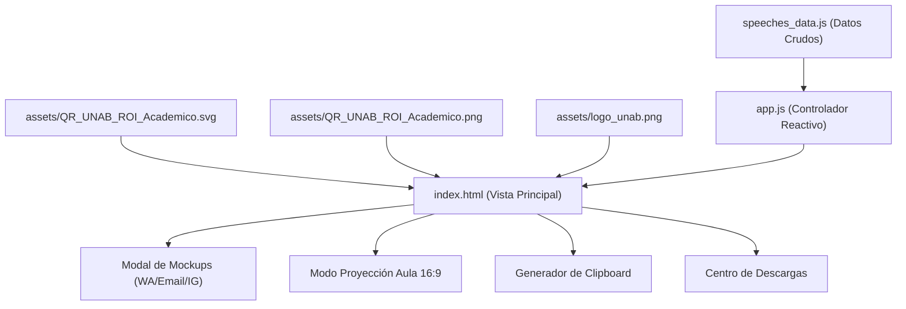

# Manual de Dependencias Core (Ledger v2): `roi-academico-unab-despliegue`
> **Proyecto**: Plataforma Web de Difusión, Despliegue Comunicativo Multicanal y Recursos de Aula  
> **Repositorio Oficial**: `rsamuel91gc/roi-academico-unab-despliegue`  
> **URL Pública Canónica**: `https://rsamuel91gc.github.io/roi-academico-unab-despliegue/`  
> **Ubicación Canónica**: `C:\Users\Samuel Garcia\.gemini\antigravity\scratch\despliegue`  
> **Conversación de Origen**: `conversation://296c85dc-ae26-4ca7-bcbf-48af09f4f178`  
> **Estándar de Calidad**: Control de Calidad e Ingeniería Inquebrantables (Cero Placeholders, Cero Código Simulado, Ledger v2)

---

## 🧭 1. Tríada Epistémica y Gobernanza de Hechos
- `[G] GENERADO`: Métricas, conteo de discursos, hashes de assets, firmas de métodos y grafos de llamadas.
- `[V] VERIFICADO`: Pruebas automatizadas (integrity + E2E Playwright), validación de URLs y códigos QR.
- `[N] NARRATIVO`: Decisiones de diseño, intenciones pedagógicas y acuerdos del protocolo `/grill-me`.

---

## 🗺️ 2. Mapeo de los 10 Puntos de Contacto del Ciclo de Vida

| Variable Crítica | 1. Entrada DOM | 2. Transporte DTO | 3. Validación | 4. Persistencia | 5. Lógica | 6. Vista UI | 7. Exportación | 8. Documentación | 9. Fixtures | 10. Tests Unitarios |
| :--- | :--- | :--- | :--- | :--- | :--- | :--- | :--- | :--- | :--- | :--- |
| `selectedFaculty` | `#custom-faculty` | `filterState.faculty` | Regex / Whitelist | `localStorage` | `applyCustomizations()` | Tarjetas / Mockup | Clipboard / URL | §4.1 | `speeches_data.js` | `test_despliegue_integrity.py` |
| `selectedCampus` | `#custom-campus` | `filterState.campus` | 4 Sedes Oficiales | `localStorage` | `applyCustomizations()` | Tarjetas / Mockup | Clipboard / URL | §4.1 | `speeches_data.js` | `test_despliegue_integrity.py` |
| `senderName` | `#custom-sender` | `filterState.sender` | Sanitización HTML | `localStorage` | `applyCustomizations()` | Tarjetas / Mockup | Clipboard | §4.2 | `speeches_data.js` | `test_despliegue_integrity.py` |
| `linkMode` | `#toggle-utm-mode` | `filterState.linkMode` | Boolean (`tinyurl`/`utm`) | `localStorage` | `resolveTargetLink()` | Badge / URL Preview| Clipboard / Link | §4.3 | URLs Canónicas | `test_despliegue_e2e_playwright.py` |
| `activePerspective` | `.btn-perspective` | `filterState.perspective`| 5 Perspectivas | `state` | `filterSpeeches()` | Grid reactivo | - | §3.1 | Catálogo 20+ | `test_despliegue_e2e_playwright.py` |
| `activeChannel` | `.btn-channel` | `filterState.channel` | 6 Canales | `state` | `filterSpeeches()` | Grid reactivo | - | §3.2 | Catálogo 20+ | `test_despliegue_e2e_playwright.py` |

---

## 📐 3. Grafo de Dependencias Estáticas y DAG Acíclico (§4.1)

---

## 🛡️ 4. Matriz de Efectos Secundarios (Blast Radius) y Seguridad

1. **Aislamiento de Entorno**:
   - La web `despliegue` es 100% cliente (estática) y no realiza peticiones destructivas (cero mutaciones POST/DELETE hacia Google Sheets).
   - Consume en modo solo lectura los enlaces canónicos del portal de encuesta.
2. **Sanitización Contra XSS**:
   - Toda entrada de usuario en la barra de personalización rápida (`#custom-sender`, `#custom-faculty`, `#custom-campus`) se escapa antes de la interpolación en el DOM mediante `escapeHtml()` o propiedades seguras (`textContent`).
3. **Persistencia Segura**:
   - `localStorage` se utiliza exclusivamente para recordar la última selección de sede/facultad del usuario en su propio navegador.

---

## 🚦 5. Pipeline de Quality Gates (G0 a G6)

- **G0 (Ledger Sync)**: Este archivo `Manual_Dependencias_despliegue.md` creado y validado sin nodos huérfanos.
- **G1 (Build y Sintaxis)**: HTML5 y JS Vanilla limpios, sin errores de compilación ni advertencias de consola.
- **G2 (Pruebas Unitarias)**: Ejecución de `tests/test_despliegue_integrity.py` con 100% de aserciones aprobadas.
- **G3 (Pruebas E2E)**: Ejecución de `tests/test_despliegue_e2e_playwright.py` validando Desktop y Móvil (Pixel 7).
- **G4 (Mobile Parity)**: Confirmación de renderizado responsive, touch targets $\ge 44\text{px}$ y contraste WCAG AA.
- **G5 (Smoke Test en Producción)**: Despliegue en GitHub Pages y verificación de HTTP 200 OK.
- **G6 (Sello Canónico)**: Registro y persistencia en `Bitacora_despliegue.md`.
